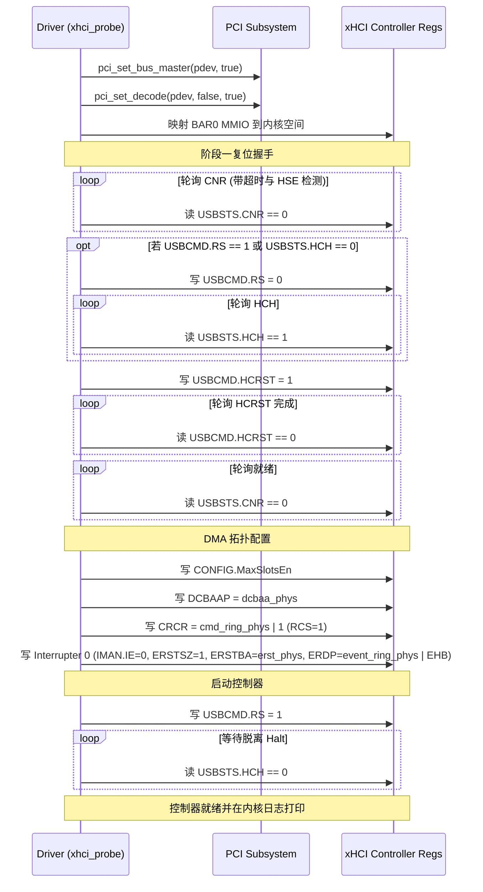

# xHCI 主机控制器阶段一（控制器骨架与 DMA 环初始化）— 设计规格

- 日期：2026-11-03
- 状态：修订中（根据 Argon 评审意见完成第 1 轮修订）
- 对应 roadmap：`docs/roadmap.md` 的 P3 / P4「USB 驱动栈」
- 前置：ARCH-9（驱动模型/PCI/总线解耦）✅、PMM / 4KB 页分配器 ✅
- 工作区：`.worktrees/usb-xhci-phase1`（分支 `feature/usb-xhci-phase1`）

---

## 1. 目标与范围

### 1.1 背景与问题
OS01 现已具备完整的 PCI 枚举与展示能力（ARCH-9 与 ARCH-12 `lspci`），并在 devfs 支持了多级路径（ARCH-11）。但在 USB 方面，`kernel/driver/` 下没有任何 USB 相关代码。USB 控制器及挂载在 USB 上的设备（如鼠标、键盘、QEMU Tablet、存储盘）均无法工作。

为了实现最终的 `lsusb` 命令与 USB 鼠标/键盘支持，首要前提是建立 USB 主机控制器驱动（Host Controller Driver, HCD）。在各种 USB 控制器规范中，xHCI（USB 3.x）是现代 PC 和虚拟化环境（QEMU q35）的通用标准，统一向下兼容 USB 1.1/2.0/3.0。

### 1.2 阶段一目标（Phase 1 Scope）
本阶段聚焦于 **xHCI 控制器的驱动骨架、PCI 绑定、寄存器映射、硬件复位握手与基础 DMA 内存拓扑初始化**：
1. **PCI 驱动自注册与使能**：
   - 通过 ARCH-9 统一的 `.pci_drivers` 节注册 xHCI PCI 驱动，匹配 Class `0x0C`、Subclass `0x03`、Prog-IF `0x30`。
   - 探针时调用 `pci_set_bus_master(pdev, true)` 开启 PCI 总线主控（使能 DMA）。
   - 调用 `pci_set_decode(pdev, false, true)` 开启 PCI 内存空间译码（使能 BAR0 MMIO）。
2. **MMIO 寄存器映射与分区**：
   - 提取 BAR0 物理地址与长度，建立内核无缓存映射（`mmio_virt`）。
   - 解析 Capability、Operational、Runtime（Interrupter 0）和 Doorbell 寄存器空间。
3. **符合规范的五步软件复位握手**：
   - 步 1：等待 `USBSTS.CNR == 0`（控制器就绪）。
   - 步 2：若 `USBCMD.RS == 1` 或 `USBSTS.HCH == 0`，写 `USBCMD.RS = 0`，等待 `USBSTS.HCH == 1`（必须在停机状态下方可复位）。
   - 步 3：写 `USBCMD.HCRST = 1`。
   - 步 4：等待 `USBCMD.HCRST == 0`（复位完成）。
   - 步 5：等待 `USBSTS.CNR == 0`（控制器内部重载就绪）。
   - 所有等待循环均设置超时时限（500ms），并检测 `USBSTS.HSE`（Host System Error）异常中断。
4. **中断屏蔽（轮询模式）**：
   - 保持 `USBCMD.INTE = 0`。
   - 清零 Interrupter 0 的 `IMAN.IE = 0`，向 `IMAN.IP` 写入 1（RW1C）清除引导固件留下的中断标志。
5. **DMA 环形拓扑初始化（4KB 物理对齐内存）**：
   - 分配 1 页 DCBAA（`alloc_4k_page()`），清零并写入 `DCBAAP`。
   - 分配 1 页 Command Ring（256 个 TRB）：
     - 槽位 `0..254` 供命令使用。
     - **槽位 255 严格配置为 Link TRB（Type 6, TC=1, Target=cmd_ring_phys）**，实现硬件环回与 Cycle Bit 自动翻转。
     - 写入 `CRCR = cmd_ring_phys | 1`（初始 Ring Cycle State RCS = 1）。
   - 分配 1 页 Event Ring（256 个 TRB）与 1 页 ERST 表（1 个条目）：
     - 填充 `RingSegmentBaseAddress = event_ring_phys`，`RingSegmentSize = 256`。
     - 配置 Interrupter 0：`ERSTSZ = 1`，`ERSTBA = erst_phys`，`ERDP = event_ring_phys | XHCI_ERDP_EHB`（清除 EHB 忙标志）。
6. **Scratchpad 检查**：
   - 解析 `HCSPARAMS2`。若 `Max Scratchpad Buffers > 0`，在阶段一如无多余缓冲区则做规范预警并优雅返回；在 QEMU 默认环境下该值为 0。
7. **控制器使能运行**：
   - 配置 `CONFIG.MaxSlotsEn = min(MaxSlots, 16)`。
   - 写入 `USBCMD.RS = 1`，等待 `USBSTS.HCH == 0` 且无 `HSE` 错误，确认进入 Running 状态。
8. **规范日志**：
   - 使用 `log_info`/`log_err` 记录初始化全过程（无 bare `printk`）。
9. **自动化测试**：
   - 宿主单元测试 `test_xhci_init.c`：通过模拟 `struct pci_device` 与 MMIO 缓冲区，完整走通 `xhci_probe` 及其错误恢复流程。
   - QEMU 环境增加 `-device qemu-xhci,id=xhci`，验证实跑日志。

### 1.3 非目标（明确不在阶段一实施）
- **不实现** 端口复位、Slot 分配与 EP0 控制传输（属于阶段二）。
- **不实现** USB 描述符解析与设备枚举（属于阶段二）。
- **不实现** `/dev/usb/` 节点暴露（属于阶段三）。
- **不实现** 用户态 `lsusb`（属于阶段四）。
- **不实现** 硬件中断处理（MSI/MSI-X/INTx）（阶段一全部采用事件环同步轮询设计）。

---

## 2. 硬件与架构设计

### 2.1 PCI 身份标识与匹配
xHCI 控制器在 PCI 配置空间中的标准类代码为：
- Base Class: `0x0C`（Serial Bus Controller）
- Subclass: `0x03`（USB Controller）
- Programming Interface (Prog-IF): `0x30`（xHCI Specification）

在 `kernel/driver/xhci.c` 中通过 `pci_device_id` 匹配：
```c
static const struct pci_device_id xhci_ids[] = {
    {
        .vendor = PCI_ID_ANY,
        .device = PCI_ID_ANY,
        .subvendor = PCI_ID_ANY,
        .subdevice = PCI_ID_ANY,
        .class_value = (0x0C << 16) | (0x03 << 8) | 0x30,
        .class_mask  = 0xFFFFFF,
    },
};
```

### 2.2 MMIO 空间布局与寄存器定义
xHCI 的 BAR0 为 64 位 MMIO 窗口。虚拟基地址记为 `mmio_virt`：

1. **Capability Registers**（偏移 `mmio_virt + 0x00`，只读）：
   - `CAPLENGTH`（8 位）：Operational 寄存器的偏移量。
   - `HCIVERSION`（16 位）：接口版本号（BCD，如 0x0100 为 1.0）。
   - `HCSPARAMS1`（32 位）：
     - Bits [7:0]: `MaxSlots`（支持的最大设备槽数）。
     - Bits [18:8]: `MaxIntrs`（支持的最大中断器数）。
     - Bits [31:24]: `MaxPorts`（根集线器端口数）。
   - `HCSPARAMS2`（32 位）：
     - Scratchpad 缓冲区数：`((val >> 21) & 0x1F) << 5 | ((val >> 27) & 0x1F)`。
   - `DBOFF`（32 位）：Doorbell Array 相对于 MMIO 基址的字节偏移量。
   - `RTSOFF`（32 位）：Runtime Registers 相对于 MMIO 基址的字节偏移量。
   - `HCCPARAMS1`（32 位）：
     - Bit 0: 64 位寻址能力（`AC64`）。
     - Bits [15:8]: 扩展能力指针 `xECP`（用于 BIOS/OS Handoff `USBLEGSUP`）。

2. **Operational Registers**（偏移 `mmio_virt + cap_length`）：
   - `USBCMD`（0x00）：
     - Bit 0: `RS`（Run/Stop，1=运行，0=停止）。
     - Bit 1: `HCRST`（Host Controller Reset，写 1 复位）。
     - Bit 2: `INTE`（Interrupter Enable，阶段一保持 0）。
   - `USBSTS`（0x04）：
     - Bit 0: `HCH`（Host Controller Halted，1=已停机，0=运行中）。
     - Bit 2: `HSE`（Host System Error，1=系统错误，严重故障）。
     - Bit 11: `CNR`（Controller Not Ready，1=未就绪，0=可访问）。
   - `PAGESIZE`（0x08）：支持的页大小位图（Bit 0 为 4KB）。
   - `CRCR`（0x18，64 位）：
     - Bits [63:6]: Command Ring 物理基地址（64 字节对齐）。
     - Bit 0: `RCS`（Ring Cycle State，初始置 1）。
   - `DCBAAP`（0x30，64 位）：Device Context Base Address Array 物理基地址（64 字节对齐）。
   - `CONFIG`（0x38，32 位）：
     - Bits [7:0]: `MaxSlotsEn`（启用的槽位数）。

3. **Runtime & Interrupter Registers**（偏移 `mmio_virt + rtsoff`）：
   - Interrupter 0 位于 `mmio_virt + rtsoff + 0x20`：
     - `IMAN`（0x00）：Bit 0 `IP`（中断待决，写 1 清零），Bit 1 `IE`（中断使能，设为 0）。
     - `IMOD`（0x04）：中断节流（设为 0）。
     - `ERSTSZ`（0x08，32 位）：Event Ring Segment Table 项数（设为 1）。
     - `ERSTBA`（0x10，64 位）：Event Ring Segment Table 物理基址（64 字节对齐）。
     - `ERDP`（0x18，64 位）：Event Ring Dequeue Pointer（Bits [63:4] 为物理地址，Bit 3 为 `EHB` 事件处理忙标志，更新时必须写 1）。

4. **Doorbell Registers**（偏移 `mmio_virt + dboff`）：
   - Doorbell 0 为 Host Controller Doorbell（敲响命令环）。

---

### 2.3 内存拓扑分配与 Link TRB 规则

所有物理页分配通过内核标准 API：
- 分配物理页：`uint64_t phys = alloc_4k_page();`
- 转换为内核虚拟地址：`void *virt = (void *)Phy_To_Virt(phys);`
- 释放物理页：`free_4k_page(phys);`

#### 1. DCBAA（Device Context Base Address Array）
- 分配 1 个 4KB 页（可支持 255 个槽位指针），清零。
- `dcbaa_phys` 写入 `DCBAAP`。

#### 2. Command Ring（命令环与 Link TRB）
- 分配 1 个 4KB 页，每个 TRB 为 16 字节，整页共 256 个 TRB。
- 全部初始化为 0。
- **TRB 255（最后一个 TRB）强制配置为 Link TRB**：
  ```c
  struct xhci_trb *link_trb = &ctrl->cmd_ring_virt[255];
  link_trb->parameter = ctrl->cmd_ring_phys; /* 指向环首 */
  link_trb->status = 0;
  link_trb->control = (6 << 10) | (1 << 1);  /* TRB Type 6 (Link), Toggle Cycle (TC) = 1 */
  ```
- **环流转与 Cycle Bit 机制**：
  - 初始 `cmd_ring_enqueue = 0`，`cmd_ring_cycle = 1`。
  - 向 `cmd_ring_virt[enqueue]` 填入命令时，将其 Cycle Bit 设为当前 `cmd_ring_cycle`。
  - 当 `enqueue` 推进到 255 时，将 Link TRB 的 Cycle Bit 置为当前 `cmd_ring_cycle`，随后翻转 `cmd_ring_cycle ^= 1`，并将 `cmd_ring_enqueue` 回绕为 0。
- `cmd_ring_phys | 1` 写入 `CRCR`（最低位 RCS = 1）。

#### 3. Event Ring 与 ERST
- 分配 1 个 4KB 页作为 Event Ring 物理段（256 个 TRB）。
- 分配 1 个 4KB 页作为 ERST 表（阶段一使用首个 16 字节条目）：
  - `erst[0].ring_segment_base_address = ctrl->event_ring_phys;`
  - `erst[0].ring_segment_size = 256;`
- 初始化 `event_ring_dequeue = 0`，`event_ring_cycle = 1`。
- **硬件出队更新与 EHB 标志**：
  - 硬件生成事件时会依据 `event_ring_cycle` 标记 TRB，并在 ERST 段末尾通过硬件计数器自动回绕（**Event Ring 严禁包含 Link TRB**）。
  - 软件处理完事件更新出队指针时，写入 `ERDP = event_ring_phys + dequeue * 16 | (1 << 3)`（Bit 3 EHB 写 1 清除忙状态）。

---

### 2.4 控制器复位与启动状态机



---

## 3. 接口与数据结构

### 3.1 公开头文件：`kernel/include/driver/xhci.h`

```c
#ifndef _DRIVER_XHCI_H
#define _DRIVER_XHCI_H

#include <stdint.h>
#include <stdbool.h>
#include <bus/pci/pci.h>
#include <bus/pci/driver.h>

#define XHCI_TRB_RING_SIZE       256
#define XHCI_ERDP_EHB            (1ULL << 3)
#define XHCI_TRB_TYPE_LINK       6
#define XHCI_TRB_LINK_TC         (1U << 1)

/* 16-byte Generic TRB (Transfer Request Block) */
struct xhci_trb {
    uint64_t parameter;
    uint32_t status;
    uint32_t control;
} __attribute__((packed));

/* Event Ring Segment Table Entry (16 bytes) */
struct xhci_erst_entry {
    uint64_t ring_segment_base_address;
    uint16_t ring_segment_size;
    uint16_t rsvdz;
    uint32_t rsvdz2;
} __attribute__((packed));

/* xHCI Controller Instance State */
struct xhci_controller {
    struct pci_device *pdev;

    /* MMIO mappings */
    uint64_t mmio_phys;
    uint64_t mmio_len;
    volatile uint8_t *mmio_virt;
    volatile uint8_t *op_regs;   /* mmio_virt + cap_length */
    volatile uint8_t *rt_regs;   /* mmio_virt + rtsoff */
    volatile uint8_t *db_regs;   /* mmio_virt + dboff */

    /* Capability caches */
    uint32_t cap_length;
    uint32_t hci_version;
    uint32_t max_slots;
    uint32_t max_ports;
    uint32_t max_intrs;
    uint32_t max_scratchpads;
    uint32_t dboff;
    uint32_t rtsoff;

    /* DCBAA */
    uint64_t dcbaa_phys;
    uint64_t *dcbaa_virt;

    /* Command Ring */
    uint64_t cmd_ring_phys;
    struct xhci_trb *cmd_ring_virt;
    uint32_t cmd_ring_enqueue;
    uint8_t cmd_ring_cycle;

    /* Event Ring */
    uint64_t event_ring_phys;
    struct xhci_trb *event_ring_virt;
    uint32_t event_ring_dequeue;
    uint8_t event_ring_cycle;

    /* ERST */
    uint64_t erst_phys;
    struct xhci_erst_entry *erst_virt;

    bool running;
};

/* PCI Driver Callbacks */
int xhci_probe(struct pci_device *pdev, const struct pci_device_id *id);
void xhci_remove(struct pci_device *pdev);
extern const struct pci_driver xhci_pci_driver;

#endif /* _DRIVER_XHCI_H */
```

---

## 4. 容错与清理机制

在 `xhci_probe` 任何步骤发生错误或在 `xhci_remove` 时，必须保证无物理页泄漏与 MMIO 泄漏：
1. 编写内部清理例程 `xhci_free_dma(struct xhci_controller *ctrl)`：
   - 若 `ctrl->erst_phys` 非 0，调用 `free_4k_page(ctrl->erst_phys)`。
   - 若 `ctrl->event_ring_phys` 非 0，调用 `free_4k_page(ctrl->event_ring_phys)`。
   - 若 `ctrl->cmd_ring_phys` 非 0，调用 `free_4k_page(ctrl->cmd_ring_phys)`。
   - 若 `ctrl->dcbaa_phys` 非 0，调用 `free_4k_page(ctrl->dcbaa_phys)`。
2. 停机与总线还原：
   - 若控制器处于运行态，写 `USBCMD.RS = 0`，等待 `USBSTS.HCH == 1`。
   - 调用 `pci_set_decode(pdev, false, false)`。
   - 调用 `pci_set_bus_master(pdev, false)`。

---

## 5. 验证与测试策略

1. **宿主单元测试 (`hosttests/cases/test_xhci_init.c`)**：
   - 构造虚构的 `struct pci_device` 与 64KB 内存缓冲区（模拟 BAR0 MMIO）。
   - 覆盖以下用例：
     - `test_xhci_cap_parsing`：解析 CAPLENGTH、MaxSlots、MaxPorts、DBOFF、RTSOFF。
     - `test_xhci_reset_handshake`：模拟 5 步复位状态转换，验证超时和 HSE 错误处理。
     - `test_xhci_command_ring_link_trb`：验证 TRB 255 的 Link TRB 结构、Cycle Bit 翻转逻辑。
     - `test_xhci_erst_and_interrupter`：验证 ERSTBA、ERSTSZ、ERDP 带 EHB 标志写入。
     - `test_xhci_probe_full_success`：验证完整 probe 执行后控制器成功转入 running 状态。
     - `test_xhci_probe_dma_cleanup_on_error`：注入故障测试资源释放无泄漏。
2. **QEMU 实机验证**：
   - Makefile QEMU 启动选项追加 `-device qemu-xhci,id=xhci`。
   - 验证内核启动日志：
     ```text
     [info] [xhci] found controller at 0000:00:xx.x, BAR0 0x...
     [info] [xhci] capabilities: max_slots=64, max_ports=4
     [info] [xhci] controller initialized and running
     ```
   - 验证内核无 panic、无死循环、终端正常进入。
